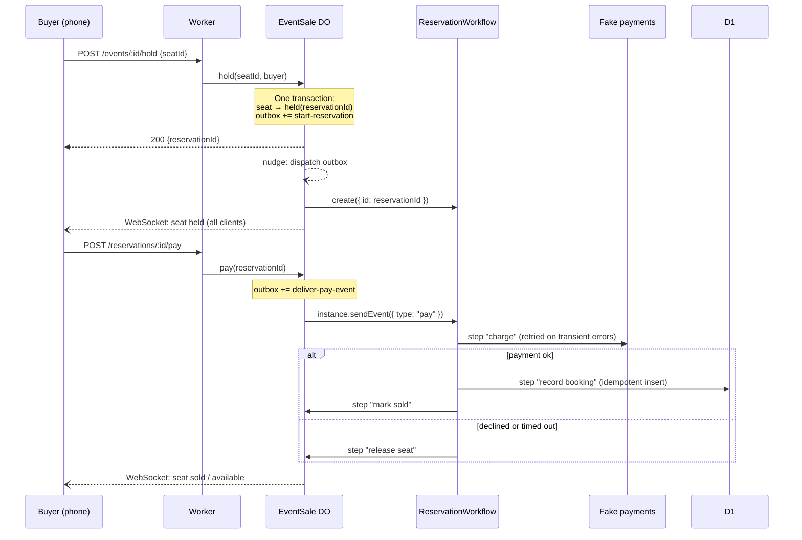

# Cloudflare Workers Talk: Ticket Booking Demo App

## 1. Purpose

A short introductory talk at a local JavaScript meet-up. The main message:

> Cloudflare Workers and their associated primitives (Durable Objects, Workflows, D1) are flexible and need very little configuration. What config there is gets replicated in local dev (`wrangler dev`), and everything else is just JavaScript.

The talk is built around a live demo: a **ticket booking app for popular events**, with robust seat reservation tied to payment. The audience takes part from their phones while the projector shows what's happening inside the system.

---

## 2. The app in one paragraph

An event goes on sale with a fixed seat map. Buyers pick a seat, which places a **hold**. They then have a limited window to **pay** (a fake payment step that can fail at random). Successful payment produces a **confirmed booking**. A decline or timeout **releases the seat** back into the pool, where someone else can grab it. The seat map updates live for everyone.

---

## 3. Architecture

| Component                                                          | Role                                                                                                                                                                   |
| ------------------------------------------------------------------ | ---------------------------------------------------------------------------------------------------------------------------------------------------------------------- |
| **Worker + static assets**                                         | Serves the buyer UI (phones) and the dashboard (projector), and routes API calls to the right Durable Object.                                                          |
| **Durable Object: `EventSale`** (one per event, SQLite storage)    | Owns the **live sale**: seat availability, holds, the transactional outbox, and the WebSocket fan-out. It's the single point of coordination while there's contention. |
| **Workflow: `ReservationWorkflow`** (one instance per reservation) | Owns the **reservation lifecycle**: waits for payment, charges, records the booking, then settles the seat. Durable, with retried steps.                               |
| **D1: `tickets`**                                                  | The **system of record** for confirmed bookings: "my bookings", check-in, refunds, reporting.                                                                          |
| **Fake payment provider** (a function or second Worker)            | Can be configured to decline payments and to fail with transient errors.                                                                                               |
| **Flagship: feature flags**                                        | The **chaos controls** and timeouts (decline rate, payment window). Evaluated with `{ eventId }` as context, so a targeting rule can give one event its own values.    |

### Responsibilities

- **DO = live inventory.** It's critical during the sale and much less so once the event sells out.
- **Workflow = everything after the hold.** It's the sole owner of the hold's lifetime.
- **D1 = permanent record.** Ordinary relational queries, with nothing that needs single-threaded coordination.

---

## 4. Reservation flow



### Steps

1. **Hold.** The DO checks that the seat is free and marks it `held` by a new `reservationId`. In the **same transaction** it adds an outbox entry `start-reservation`. Because the DO handles one request at a time, two holds on the same seat can never race.
2. **Dispatch (outbox).** At the end of the request a **nudge** tries to dispatch immediately: `env.RESERVATION.create({ id: reservationId, params })`. If that fails, or the isolate is evicted first, the DO's **alarm** retries with backoff.
3. **Wait for payment.** The workflow waits with `step.waitForEvent("payment submitted", { type: "pay", timeout: "90 seconds" })`. A timeout is treated as abandonment.
4. **Pay.** The buyer taps Pay. The DO records the payment intent and an outbox entry that delivers the `pay` event to the workflow instance. This is the same pattern again: the state change and the intent to notify are committed together.
5. **Charge.** `step.do("charge", { retries }, ...)` calls the fake provider with `idempotencyKey: reservationId`.
   - **Transient error** (timeout or 503): Workflows retries automatically.
   - **Decline**: return `{ ok: false }` (or throw `NonRetryableError`).
6. **Record booking** (success only). Insert into D1 as an idempotent step.
7. **Settle.** Call `EventSale.settle(reservationId, ok)` to mark the seat sold or release it. The DO broadcasts the change to every connected client.

---

## 5. Reliability layers (the core of the talk)

| Layer                       | Guarantee                                    | Mechanism                                                                                            |
| --------------------------- | -------------------------------------------- | ---------------------------------------------------------------------------------------------------- |
| **1. Transactional outbox** | Every committed hold starts a workflow       | Seat change and outbox entry written in one DO transaction; nudge for speed, alarm as the safety net |
| **2. Durable workflow**     | Every started reservation runs to completion | Workflow steps are persisted and retried; sleeps and waits survive restarts                          |
| **3. Idempotency**          | Retries are always safe                      | `reservationId` is the key at every boundary                                                         |

After the hold, **the workflow acts as the outbox for everything downstream of payment**. Each step is durable and retried, so no second outbox is needed for the D1 write or the settle call.

### Idempotency at each boundary

| Boundary             | Key                                    | Duplicate behaviour                                           |
| -------------------- | -------------------------------------- | ------------------------------------------------------------- |
| DO → Workflow start  | Workflow instance ID = `reservationId` | "Instance already exists" is treated as success               |
| Workflow → Payments  | `idempotencyKey = reservationId`       | Provider returns the original result and doesn't charge twice |
| Workflow → D1        | `bookings.id = reservationId`          | `ON CONFLICT (id) DO NOTHING`                                 |
| Workflow → DO settle | `reservationId`                        | Seat only changes if it's still held by that reservation      |

### Rules

- **The workflow owns the hold's lifetime.** The DO never releases a hold on a timer of its own while a payment might be in progress, because that risks taking money for a seat that's been resold. Any safety-net alarm in the DO has to be much longer than the workflow's longest possible run.
- **Write to D1 before marking the seat sold.** If something stalls between the two steps, the buyer already has a booking and the seat just looks held a little longer.
- **Cancellations during the sale go through the DO**, so the seat returns to the pool and the map updates. After the sale they can be handled in D1 alone.
- **Defence in depth:** a unique constraint on `(event_id, seat_id)` in D1 means even a bug in the DO couldn't double-sell a seat.

---

## 6. Data model

### `EventSale` DO (SQLite storage)

```sql
CREATE TABLE seats (
  id             TEXT PRIMARY KEY,
  status         TEXT NOT NULL CHECK (status IN ('available', 'held', 'sold')),
  reservation_id TEXT,
  held_at        INTEGER
);

CREATE TABLE outbox (
  id           INTEGER PRIMARY KEY AUTOINCREMENT,
  type         TEXT NOT NULL,          -- 'start-reservation' | 'deliver-pay-event'
  payload      TEXT NOT NULL,          -- JSON
  status       TEXT NOT NULL DEFAULT 'pending',  -- 'pending' | 'done'
  attempts     INTEGER NOT NULL DEFAULT 0,
  next_attempt INTEGER NOT NULL,
  last_error   TEXT
);
```

### D1 `tickets`

```sql
CREATE TABLE bookings (
  id          TEXT PRIMARY KEY,        -- = reservationId
  event_id    TEXT NOT NULL,
  seat_id     TEXT NOT NULL,
  customer    TEXT NOT NULL,
  payment_ref TEXT NOT NULL,
  created_at  INTEGER NOT NULL DEFAULT (unixepoch()),
  UNIQUE (event_id, seat_id)
);
```

---

## 7. Sketch code

### Outbox dispatch in the DO

```js
async dispatchOutbox() {
  const due = this.sql.exec(
    `SELECT * FROM outbox WHERE status = 'pending' AND next_attempt <= ?`, Date.now()
  ).toArray();

  for (const entry of due) {
    try {
      if (this.chaos.blockOutbox) throw new Error("downstream unavailable");
      await this.handlers[entry.type](JSON.parse(entry.payload));
      this.sql.exec(`UPDATE outbox SET status = 'done' WHERE id = ?`, entry.id);
    } catch (err) {
      const delay = Math.min(30_000, 500 * 2 ** entry.attempts);
      this.sql.exec(
        `UPDATE outbox SET attempts = attempts + 1, next_attempt = ?, last_error = ? WHERE id = ?`,
        Date.now() + delay, String(err), entry.id
      );
    }
    this.broadcastOutboxState();
  }
  await this.scheduleAlarmIfPending();
}

async alarm() { await this.dispatchOutbox(); }
```

The nudge is called at the end of `hold()` and `pay()`, for example via `this.ctx.waitUntil(this.dispatchOutbox())`.

### Workflow

```js
export class ReservationWorkflow extends WorkflowEntrypoint {
  async run(event, step) {
    const { reservationId, eventId, seatId, customer } = event.payload;

    const paid = await step
      .waitForEvent("payment submitted", { type: "pay", timeout: "90 seconds" })
      .catch(() => null);

    const result = paid
      ? await step.do(
          "charge",
          { retries: { limit: 3, delay: "1 second", backoff: "exponential" } },
          () => fakePay(this.env, { idempotencyKey: reservationId }),
        )
      : { ok: false, reason: "timeout" };

    if (result.ok) {
      await step.do("record booking", () =>
        this.env.DB.prepare(
          `INSERT INTO bookings (id, event_id, seat_id, customer, payment_ref)
           VALUES (?, ?, ?, ?, ?) ON CONFLICT (id) DO NOTHING`,
        )
          .bind(reservationId, eventId, seatId, customer, result.ref)
          .run(),
      );
    }

    await step.do(result.ok ? "mark sold" : "release seat", () =>
      this.env.EVENT_SALE.getByName(eventId).settle(reservationId, result.ok),
    );
  }
}
```

### Configuration (`wrangler.jsonc`)

```jsonc
{
  "name": "tickets",
  "main": "src/index.js",
  "compatibility_date": "2026-11-01",
  "assets": { "directory": "./public" },
  "durable_objects": {
    "bindings": [{ "name": "EVENT_SALE", "class_name": "EventSale" }],
  },
  "migrations": [{ "tag": "v1", "new_sqlite_classes": ["EventSale"] }],
  "workflows": [
    {
      "name": "reservation",
      "binding": "RESERVATION",
      "class_name": "ReservationWorkflow",
    },
  ],
  "d1_databases": [
    {
      "binding": "DB",
      "database_name": "tickets",
      "database_id": "<id>",
    },
  ],
}
```

That's the whole of the infrastructure. Retry policy, backoff, hold timeout, schemas and the outbox are all JavaScript. Check method names and config keys (`getByName`, `waitForEvent`, how a duplicate instance ID is reported) against the current docs before the talk.

---

## 8. Dashboard (projector)

- **Seat map**, live over WebSockets: available, held (with countdown), sold. Declined seats flash before they return to the pool.
- **Outbox panel**: entries as cards moving from pending to done, showing attempt count and next retry time.
- **Workflow panel**: active reservations and their current step (waiting for payment, charging, retry _n_, recording, settled).
- **Chaos controls**, all independent. Each is a Flagship feature flag (`flags.ts`). The Worker binding is read-only, so they're flipped in the Cloudflare dashboard (production) or the Local Explorer / `cf flagship ... --local` (local dev), not from this page:
  - **`decline-rate`** (off, 10%, 50%, all): seats get released and resold.
  - **Flaky-provider toggle** (not built yet): transient 503s, which Workflows step retries recover from.
  - **Break-outbox switch** (not built yet): workflow starts fail, holds pile up as "awaiting workflow", and the backlog drains when the switch is flipped back.

---

## 9. Demo script

1. **Show the config file.** "This is all the infrastructure." Run `wrangler dev` and point out that DOs, alarms, workflows and D1 all run locally.
2. **QR code on screen.** The audience opens the event and the sale starts. Watch the map fill up and point out that there's no double-booking, with no locks written.
3. **Turn up the decline rate.** Seats come back and there's a second rush. Explain how the workflow owns the hold, and how decline differs from timeout.
4. **Make the provider flaky.** Payments still succeed after retries. Explain step retries and the idempotency key.
5. **Break the outbox.** Holds succeed but the workflows don't start, and the outbox piles up. Flip it back and the backlog drains. Explain atomic writes, the nudge and the alarm.
6. **Finish on D1.** Run `SELECT * FROM bookings` live: the record of tonight's sale. Maybe add a leaderboard (fastest payer, most declines).

---

## 10. Talk outline (around 15–20 minutes)

1. Workers in a minute: isolates, deployed globally, no servers to run.
2. The problem: selling limited seats under contention, with payments that fail.
3. Architecture slide: DO, then Workflow, then D1, and who owns what.
4. The three reliability layers.
5. Live demo (section 9).
6. Comparison slide: this `wrangler.jsonc` next to the AWS equivalent (API Gateway, Lambda, DynamoDB with conditional writes, Step Functions, SQS with a DLQ, EventBridge, IAM).
7. "Why not just D1?" slide: a DO is a database with a single-threaded process, a scheduler and a WebSocket server attached. Use it when the data needs all three.
8. Wrap-up and links.

---

## 11. Open questions

- Single event, or several events to show one DO per event?
- How do buyers identify themselves: anonymous nickname, or a magic link?
- Is the fake payment provider an in-process function, or a separate Worker (which would show service bindings)?
- A fallback if venue wifi fails: pre-recorded run, or simulated buyers driven by a script?
- Deploy to production for the demo, or run locally behind a tunnel? Flagship changes are instant locally but can take up to 30 seconds to apply in production, which slows down the chaos steps.
